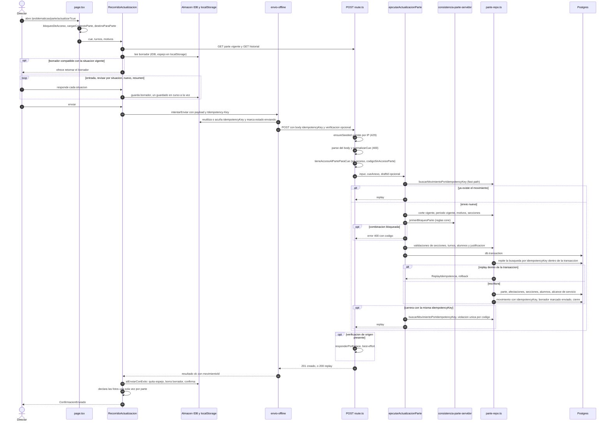

# Flujo "Actualizar el parte"

Mapa del flujo tal como queda en la rama `fix/actualizar-flujo-riesgos` (tareas R1 a R7, R2b y R2c). Describe el comportamiento actual; la sección de propuestas de UX no está implementada.

## Diagrama

## Capas

| Capa | Archivo | Responsabilidad |
|---|---|---|
| Página | `app/problematicas/parte/actualizar/page.tsx` | Guarda de acceso, contexto del establecimiento, redirección si el parte no está en actualizar |
| Recorrido | `components/infraestructura/actualizar/recorrido-actualizacion.tsx` | Carga, pasos del asistente, borrador, envío y cola offline |
| Consistencia cliente | `components/infraestructura/actualizar/consistencia-actualizacion.ts` | Adapta las respuestas del formulario a las reglas comunes |
| Reglas comunes | `lib/infraestructura/consistencia-parte.ts` | Reglas de bloqueo, sugerencia de severidad, alcance |
| Reglas servidor | `lib/infraestructura/consistencia-parte-servidor.ts` | Adaptador servidor de las mismas reglas |
| Borrador | `lib/infraestructura/parte/borrador-formulario.ts`, `lib/infraestructura/parte/recorrido-actualizacion-borrador.ts` | Persistencia y validación del borrador |
| Cola offline | `lib/infraestructura/parte/envio-offline.ts`, `lib/infraestructura/parte/cola-trabajos-envio.ts` | Reintentos, estado del envío, `idempotencyKey` reutilizada entre reintentos |
| Almacenamiento | `lib/infraestructura/parte/almacen-indexeddb.ts` | IndexedDB `parte-offline` |
| Ruta | `app/api/problematicas/parte/route.ts` | Límite por IP, parseo, acceso, respuesta HTTP |
| Límites y acceso | `lib/infraestructura/limites.ts`, `lib/infraestructura/acceso-parte.ts` | Límite por IP, credencial por CUE |
| Validación | `lib/infraestructura/validacion-trayectoria.ts` | Esquema del input y normalización de `rigeDesde` |
| Caso de uso | `lib/infraestructura/parte/actualizar-parte.ts` | `ejecutarActualizacionParte`: idempotencia, validación, transacción |
| Idempotencia | `lib/infraestructura/parte/idempotencia.ts` | Detección de violación única por código del driver |
| Repositorio | `lib/infraestructura/parte/parte-repo.ts` | Lecturas y escrituras, reciben `db` o la transacción `tx` |

## Pasos del asistente

El estado `etapa` del recorrido toma estos valores:

| Etapa | Qué muestra | Transición |
|---|---|---|
| `entrada` | Situación vigente del establecimiento, historial y fotos seleccionadas (`entrada-actualizar.tsx`) | Va a `{ revisar: 0 }` si hay situaciones en seguimiento, si no a `nuevo` |
| `{ revisar: i }` | Una pantalla por situación en seguimiento | Avanza a la siguiente; la última pasa a `nuevo` |
| `nuevo` | Situaciones nuevas (pregunta, datos, causa) | Va a `resumen` |
| `resumen` | Resumen y botón de envío | Envía; con éxito pasa a `enviado` |
| `enviado` | Confirmación | Recarga el estado vigente |

El indicador "Paso X de N" usa `N = situaciones + 2` (`recorrido-actualizacion.tsx`, líneas 735 y 736).

## Zona horaria

- El servidor calcula fechas en Buenos Aires con `lib/infraestructura/zona-horaria.ts` (`calendarioBA`, `instanteBA`, `sumarMesesBA`). Buenos Aires es UTC-3 todo el año, así que el desfasaje es fijo y no depende de `TZ` del proceso.
- Lo usan `lib/infraestructura/vigencia-eleccion.ts` y `lib/infraestructura/vigencia-rango.ts`, además de `consistencia-parte.ts` por medio de esas funciones.
- En el cliente, `components/infraestructura/vigencia-chips.tsx` y `components/infraestructura/reporte-inicial-form.tsx` usan el mismo helper. `algo-nuevo.tsx` ya mostraba los días con `Intl` y zona de Buenos Aires.
- `rigeDesde` lo fija el cliente al pulsar "enviar" (`new Date()`) para que una respuesta encolada conserve su fecha de acción. El esquema acepta valores pasados hasta 12 meses y recorta a la hora del servidor los futuros dentro de una tolerancia de 1 hora (`TOLERANCIA_RELOJ_MS` en `vigencia-rango.ts`). Más allá de esa tolerancia responde 400.
- `Dockerfile` define `ENV TZ=America/Argentina/Buenos_Aires` (línea 40). Es una capa de consistencia del contenedor; el cálculo de fechas no depende de ella.

## Propuestas de UX (no implementadas)

Ordenadas por prioridad. Cada una parte de lo observado en el código del asistente.

1. **Unificar los avisos en una sola región.** `avisoBorrador`, `avisoAlmacen`, `estadoAvisoEnvio` y el error de envío pueden mostrarse a la vez (`recorrido-actualizacion.tsx`, líneas 785, 786 y 965). La frase "Puede enviar las respuestas." se repite en seis mensajes. Propuesta: una región con prioridad (un error gana a un aviso informativo) y una sola frase de contexto.
2. **Explicar el envío encolado.** Cuando el envío queda en `pendiente-envio` o `error-servidor`, la confirmación llega después, por reintento automático o por el service worker (`alEnviarEnSegundoPlano`). Hoy el botón solo dice "Envío pendiente". Propuesta: en el resumen, indicar qué quedó guardado en el dispositivo, cuándo se confirma y qué debe hacer el director si no se confirma.
3. **Reducir pasos cuando no hay cambios.** El recorrido exige una pantalla por situación aunque la mayoría siga igual. Propuesta: una lista de revisión con "sin cambios" por fila y edición solo de las filas que cambian. Reduce N sin quitar ninguna respuesta.
4. **Dar motivo al descartar un borrador.** Cuando la situación cambió, el aviso "La situación cambió desde que empezó" (línea 310) descarta el borrador sin decir qué cambió. Propuesta: listar las situaciones afectadas y ofrecer retomar solo las respuestas que siguen vigentes.
5. **Estado de las fotos por foto.** Las fotos tienen un camino propio (`enviarSoloFotos`, `vincularFotosPreparadas`, `errorFotos`) y se declaran una vez por parte. El director ve un error general pero no qué foto quedó pendiente. Propuesta: estado por foto (subida, pendiente, error) con reintento individual.

## Referencias

- Tareas: `odd/tasks/actualizar-flujo-riesgos.md`, `odd/tasks/actualizar-parte-correcciones.md`
- Fotos: `lib/infraestructura/fotos/flujo-formulario.ts`
- Estado del envío: `components/infraestructura/estado-envio-aviso.tsx`
